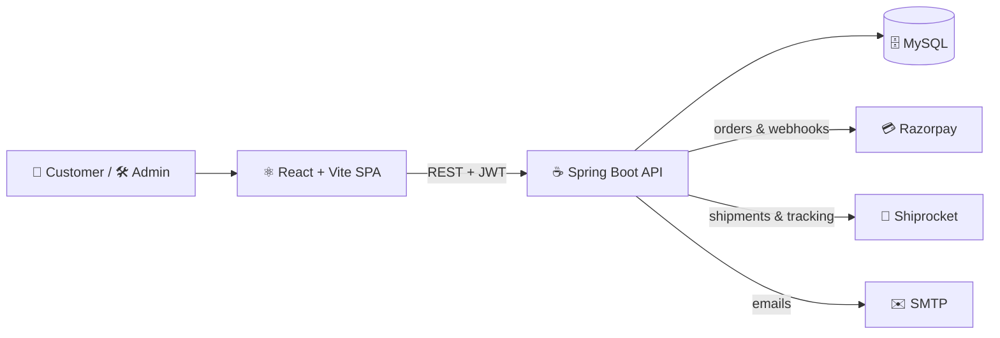

<div align="center">

# 👖 TrendsFit

### Premium Jeans, Shirts & T-Shirts — a full-stack fashion e-commerce platform 🛍️

_Mobile-first storefront • Razorpay payments • Shiprocket shipping • 7-day exchange • Powerful admin panel_


</div>

---

> ⚠️ **Honest status:** the React frontend, domain logic and SQL schema are tested. The **Spring Boot backend has not been compiled or run by the author in the build sandbox** (Maven Central was unreachable there). Run `mvn test` first and fix anything it reports. Razorpay, Shiprocket and email were never called live. See [Not yet verified](#-not-yet-verified--needs-your-credentials). This project is **not** claimed production-ready.

## 📑 Table of contents

- [✨ Features](#-features) · [🧰 Tech stack](#-tech-stack) · [🏗️ Architecture](#️-architecture) · [🗂️ Project structure](#️-project-structure)
- [🚀 Quick start](#-quick-start) · [🔐 Configuration](#-configuration) · [🧪 Tests](#-tests)
- [🛠️ Admin panel](#️-admin-panel) · [⚙️ Backend internals](#️-backend-internals) · [🔒 Security](#-security) · [❌ Not yet verified](#-not-yet-verified--needs-your-credentials) · [🆕 Changelog](#-latest-update) · [📝 Notes](#-notes)

---

## ✨ Features

### 🛒 Storefront

|                            |                                                                                                |
| -------------------------- | ---------------------------------------------------------------------------------------------- |
| 🛍️ **Catalog**             | Products with size × colour variants, server-side search, filters, sorting, pagination         |
| 🔎 **Smart search**        | Product suggestions appear while you type                                                      |
| 📏 **Size finder**         | Helps shoppers pick the right fit                                                              |
| ⭐ **Reviews & wishlist**  | Ratings, moderated reviews, saved items                                                        |
| 🛒 **Cart & checkout**     | Guest checkout, coupons, totals always recalculated on the server                              |
| 🔁 **Safe checkout**       | Duplicate clicks never create two orders (idempotent order creation)                           |
| 📍 **Pincode autofill**    | Enter a 6-digit pincode and city/state fill automatically                                      |
| 📱 **Mobile number rules** | Exactly 10 digits (6–9 start), checked on the browser _and_ the server                         |
| 💬 **Support chat**        | Customers chat with your team from the site                                                    |
| 🔁 **Exchange**            | Within 7 days of delivery, otherwise _"Exchange period expired"_ (no cancel option, by design) |
| 🧾 **Invoice**             | Downloadable non-GST invoice (`TF-YYYY-000123`)                                                |
| 👤 **Accounts**            | Register/login, email verification, password reset, saved addresses, order history             |
| ✉️ **Emails**              | Account verification, password reset and order confirmation                                    |
| ⏳ **Auto-expiry**         | Unpaid online orders expire after 30 minutes and stock is released                             |
| 🔎 **SEO**                 | `sitemap.xml`, `robots.txt`, canonical + Open Graph tags, JSON-LD                              |

### 💳 Payments & 🚚 Shipping

- 💳 **Razorpay** — backend-created orders, HMAC signature verification, webhook with de-duplication. A browser message never marks an order as paid.
- 💵 **Cash on Delivery** — with an order-value limit.
- 🚚 **Shiprocket** — serviceability check, shipment + AWB, label, tracking webhook. Nothing is invented when credentials are missing; you get one clear notice instead.

### 🛠️ Admin panel

- 📊 Dashboard with **real** KPIs, revenue **circular progress** (target vs. achieved) and a revenue trend (daily / weekly / monthly)
- 👕 Product management: images, prices, sale price, sizes, colours, stock, SEO
- 📥 **CSV import** — bulk-add products from a spreadsheet
- 🖼️ **Image uploads** — product and banner images (type and size checked)
- 📦 **Inventory & stock history** — low-stock alerts and a log of every stock change
- 📦 Orders, payments & refunds, COD tracking, shipments, exchanges
- 👥 Customers, coupons, reviews, banners, categories, newsletter
- 👥 **Admin users & permissions** — add staff and control what each role can see or do
- ⚙️ Settings (store, shipping, payments, notifications), notification bell, audit log
- 🔑 Role-based access: **Super Admin · Admin · Product Manager · Order Manager · Support Manager**
- 📱 Fully responsive: sidebar on desktop, drawer on mobile

---

## 🧰 Tech stack

| Layer               | Technology                                                                               |
| ------------------- | ---------------------------------------------------------------------------------------- |
| ☕ **Backend**      | Java 21, Spring Boot 3.5, Spring Security (stateless JWT), Spring Data JPA, JdbcTemplate |
| 🗄️ **Database**     | MySQL 8 with **Flyway** migrations                                                       |
| ⚛️ **Frontend**     | React 18, Vite, React Router 7, Bootstrap 5, Axios                                       |
| 💳 **Integrations** | Razorpay (payments), Shiprocket (shipping), SMTP (email)                                 |
| 🧪 **Testing**      | JUnit 5, Vitest + Testing Library, Playwright (browser checks), SQL verification scripts |
| 🔧 **CI**           | GitHub Actions (`.github/workflows/ci.yml`)                                              |

## 🏗️ Architecture



## 🗂️ Project structure

```text
TrendsFit-Java/
├── 📄 README.md · CHANGELOG.md · .gitignore · .env.example
├── 🔧 .github/
│   └── workflows/ci.yml                 ← GitHub Actions (auto test/build)
├── 📚 docs/                             ← Architecture, Deployment, Security, Live-testing
├── 🧪 scripts/                          ← run-domain-tests.sh, verify-sql*.sh, mock-api.mjs (test only)
│
├── ☕ backend/                           (Spring Boot, Java 21)
│   ├── pom.xml
│   └── src/
│       ├── main/java/in/trendsfit/
│       │   ├── config/        AppConfig (env variables)
│       │   ├── domain/        pure business rules (pricing, coupons, invoice, JWT, validators…)
│       │   ├── model/         DB entities (User, Product, Order, Payment, Shipment…)
│       │   ├── repo/          Spring Data repositories
│       │   ├── security/      SecurityConfig, JWT + rate-limit + security-header filters
│       │   ├── integration/   Razorpay and Shiprocket clients
│       │   ├── service/       Catalog, Order, Payment, Shipping, Exchange, Auth, Admin, Analytics…
│       │   └── web/           REST controllers + global error handler
│       ├── main/resources/
│       │   ├── application.yml            (only ${ENV} placeholders)
│       │   ├── db/migration/              V1 core · V2 settings · V3 admin panel (Flyway)
│       │   └── db/seed-dev/               V100 demo catalog (dev profile only)
│       └── test/                          domain + integration tests
│
└── ⚛️ frontend/                          (React 18 + Vite)
    ├── index.html · package.json · vite.config.js
    ├── public/                            favicon, demo images
    └── src/
        ├── main.jsx · App.jsx · styles.css
        ├── pages/         Home, Shop, Product, Cart, Checkout, Order, Account, Auth…
        ├── components/    Layout, ProductCard, SearchSuggest, SizeFinder, BannerStrip…
        ├── admin/         Dashboard, Reports, Products, Inventory, Orders, Support, Settings…
        ├── lib/           api, cart, forms, money, razorpay, seo…
        └── test/          frontend tests
```

> 📁 Uploaded images are saved in an `uploads/` folder at runtime. It is git-ignored and is not part of the repository.

---

## 🚀 Quick start

**Requirements:** ☕ JDK 21 · 🧰 Maven 3.9+ · 🟢 Node 20+ · 🗄️ MySQL 8

```bash
# 1️⃣ Database
mysql -uroot -p -e "CREATE DATABASE trendsfit CHARACTER SET utf8mb4; \
  CREATE USER 'trendsfit'@'localhost' IDENTIFIED BY 'change-me'; \
  GRANT ALL ON trendsfit.* TO 'trendsfit'@'localhost';"

# 2️⃣ Backend  (dev profile also loads clearly-labelled DEMO products)
cp .env.example .env        # fill JWT_SECRET (32+ chars) and ADMIN_BOOTSTRAP_*; export these variables
cd backend && SPRING_PROFILES_ACTIVE=dev mvn spring-boot:run

# 3️⃣ Frontend
cd frontend && npm ci && npm run dev      # http://localhost:5173  (proxies /api to the backend)
```

- 🌐 Storefront: `http://localhost:5173`
- 🛠️ Admin: `http://localhost:5173/admin` (sign in with the bootstrap admin you configured)
- 🔌 The backend port is `PORT` (default `8081`); the Vite proxy target lives in `frontend/vite.config.js`.
- 🎭 The `dev` profile loads 20 demo products from `db/seed-dev`.
- 🏭 For production use the default profile (no demo data) and set real environment variables.

## 🔐 Configuration

All secrets come from **environment variables** — none are stored in the code. See `.env.example`.

| Group         | Variables                                                                                                                     |
| ------------- | ----------------------------------------------------------------------------------------------------------------------------- |
| 🗄️ Database   | `DB_URL` `DB_USERNAME` `DB_PASSWORD`                                                                                          |
| 🔑 Auth       | `JWT_SECRET` `JWT_TTL_MINUTES` `ADMIN_BOOTSTRAP_EMAIL` `ADMIN_BOOTSTRAP_PASSWORD`                                             |
| 🌍 URLs       | `PUBLIC_URL` `FRONTEND_URL` `CORS_ORIGINS`                                                                                    |
| 💳 Razorpay   | `RAZORPAY_KEY_ID` `RAZORPAY_KEY_SECRET` `RAZORPAY_WEBHOOK_SECRET`                                                             |
| 🚚 Shiprocket | `SHIPROCKET_EMAIL` `SHIPROCKET_PASSWORD` `SHIPROCKET_WEBHOOK_TOKEN` `SHIPROCKET_PICKUP_LOCATION` `SHIPROCKET_PICKUP_POSTCODE` |
| ✉️ Email      | `MAIL_ENABLED` `MAIL_HOST` `MAIL_PORT` `MAIL_USERNAME` `MAIL_PASSWORD` `MAIL_FROM`                                            |
| 🏪 Business   | `BUSINESS_NAME` `BUSINESS_EMAIL` `BUSINESS_WHATSAPP` `BUSINESS_ADDRESS`                                                       |
| 📦 Rules      | `SHIPPING_FLAT_RATE` `SHIPPING_FREE_ABOVE` `COD_ENABLED` `EXCHANGE_WINDOW_DAYS`                                               |

> 💡 Leave Razorpay / Shiprocket / mail blank and that integration simply shows as "not configured" — the rest of the store still works.

## 🧪 Tests

| Layer                   | Command                                                                               | Needs           |
| ----------------------- | ------------------------------------------------------------------------------------- | --------------- |
| ☕ Pure domain logic    | `sh scripts/run-domain-tests.sh`                                                      | JDK only        |
| 🗄️ SQL schema & queries | `DB_CMD="mysql -uroot -p" sh scripts/verify-sql.sh` and `scripts/verify-sql-admin.sh` | MySQL / MariaDB |
| ⚛️ Frontend + build     | `cd frontend && npm test && npm run build`                                            | Node            |
| 🌱 Spring integration   | `cd backend && mvn test`                                                              | Maven + Docker  |

---

## 🛠️ Admin panel

Open `/admin` after signing in. Highlights:

- 🔵 **Revenue ring** — pick Today / 7 days / 30 days / custom, set a target, see % reached, remaining amount and change vs. the previous period (handles a zero target and values above 100%).
- 🔗 **KPI cards** link straight to the matching filtered page.
- 🏬 **View store** opens the storefront in one reusable tab, so the admin stays open.
- 📦 **Inventory & stock** — see low-stock items and the history of every stock change.
- 👥 **Admin users & permissions** — create staff accounts and choose their role and permissions.
- 💬 **Support chat** with unread badges and read receipts (polling — not real-time sockets).
- 🔔 **Notifications** for new orders, failed payments, low stock, exchanges, refunds and messages.

## ⚙️ Backend internals

- 🔁 **Idempotent orders** — each checkout carries a key, so a double click or retry returns the same order.
- ⏳ **Scheduled job** — unpaid online orders expire after 30 minutes and their stock goes back.
- ✉️ **Email types** — verification, password reset and order confirmation (SMTP; skipped when mail is not configured).
- 🖼️ **Uploads** — images only, size-limited (3 MB) and checked by file signature, not just file name.
- 🧾 **Stock movements** — every stock change (initial stock, admin edit, sale, release) is recorded per variant.

## 🔒 Security

🔐 BCrypt password hashing · 🪪 stateless JWT · 🛡️ role/permission checks on every admin endpoint · 🚦 rate limiting & account lockout · 🧱 security headers · 🖼️ upload magic-byte checks · 📜 audit log · 🙈 no secrets in the repository

---

## ❌ Not yet verified / needs your credentials

Honesty first — these have **not** been tested end-to-end:

- ☕ **Spring backend compile + `mvn test`** — run it first and send errors back.
- 💳 **Razorpay** checkout, signature and webhook — needs test keys and a public webhook URL.
- 🚚 **Shiprocket** auth, pincode, shipment, label, tracking, reverse pickup for exchanges — needs an account.
- ✉️ **Email/SMTP and WhatsApp** — not verified.
- 📍 **Live pincode lookup** (`api.postalpincode.in`) — tested with a stubbed response only.
- 📱 **Real devices** — UI checked in headless Chromium (375 / 768 / 1280 px) against a mock API.
- 🎭 Demo products and `scripts/mock-api.mjs` are for development/testing only.

## 🆕 Latest update

See [CHANGELOG.md](CHANGELOG.md) for every file. Recently: responsive admin panel, revenue progress ring, support chat, settings, shipping notice (no duplicate error toasts), password show/hide, search suggestions, mobile/pincode/required-field validation, product page image fix, compact product form, and variant-save fixes.

## 📝 Notes

- 🔑 The JWT carries the role: a demoted admin keeps access until the token expires (default 12 h).
- ⏳ Unpaid online orders auto-expire after 30 minutes and stock is released — a system rule, not a customer cancel.
- ⚖️ Legal pages (privacy, returns, terms) are templates — have them reviewed.
- 🗄️ Flyway migrations `V2__app_settings.sql` and `V3__admin_panel.sql` only add tables. If you created your own V2/V3, rename yours.

## 📚 Docs

[`docs/ARCHITECTURE.md`](docs/ARCHITECTURE.md) · [`docs/DEPLOYMENT.md`](docs/DEPLOYMENT.md) · [`docs/SECURITY.md`](docs/SECURITY.md) · [`docs/LIVE_TESTING.md`](docs/LIVE_TESTING.md)

---

<div align="center">

Made with ❤️ in India 🇮🇳 — if you like this project, give it a ⭐ on GitHub!

</div>
